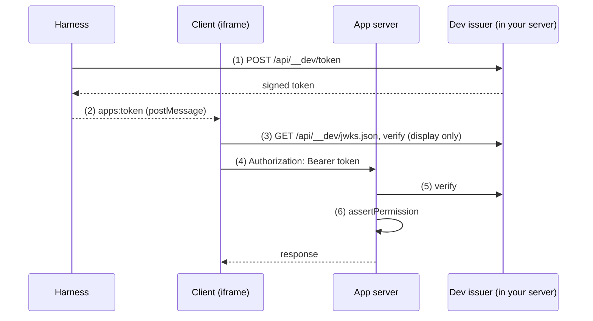
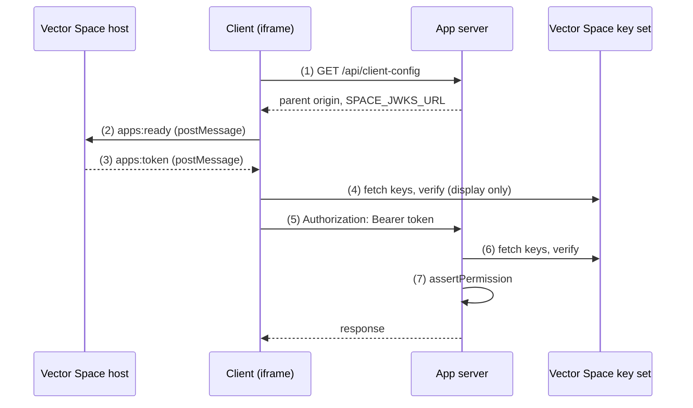

Build a small app, run it in the [harness](../sdk/glossary.md#harness) on your machine, then add it to a [space](../vector-space/glossary.md#space) in [Vector Space](../vector-space/glossary.md#vector-space). Part 2 needs [staff](../vector-space/glossary.md#staff) to register the app, and Part 1 does not. The app has one [app page](./glossary.md#app-page) that only a [member](../vector-space/glossary.md#member) who holds the `hello:view` [capability](./glossary.md#capability) can open. At the end, that page shows the ids of the member and the space from a token that your server verified. A check in the browser is display only: the server check decides.

import DiagramControls from '@site/src/components/DiagramControls';

## Prerequisites

- [ ] `npm` and [Node.js](https://nodejs.org/en/download) 22.12 or later.
- [ ] A GitHub personal access token (classic) with the `read:packages` scope. [Create a classic token](https://docs.github.com/en/authentication/keeping-your-account-and-data-secure/managing-your-personal-access-tokens#creating-a-personal-access-token-classic).
- [ ] For Part 2 only: staff who register the app.

## Part 1: Run the app locally

### 0. Set up access to the package registry

The scaffold command and the `@vectoragents/vs-apps` package come from GitHub Packages, the package registry of GitHub. GitHub Packages answers only a request that carries your token. Tell `npm` where to find the `@vectoragents` packages, then give it your token.

Add these two lines to the file `~/.npmrc` in your home folder. On Windows the file is `%USERPROFILE%\.npmrc`. Create it if it does not exist. The project does not exist yet, so the lines go in your home folder and not in a project.

```text title="~/.npmrc"
# added-start
@vectoragents:registry=https://npm.pkg.github.com
//npm.pkg.github.com/:_authToken=${GITHUB_PACKAGES_TOKEN}
# added-end
```

Write `${GITHUB_PACKAGES_TOKEN}` literally. `npm` reads the token from the environment variable `GITHUB_PACKAGES_TOKEN` when it runs, so the file holds no secret. The project that the scaffold command creates has its own `.npmrc` with the same two lines.

Export your token in the terminal where you run the next commands.

```bash
export GITHUB_PACKAGES_TOKEN=YOUR_GITHUB_PACKAGES_TOKEN
```

In PowerShell, run `$env:GITHUB_PACKAGES_TOKEN = "YOUR_GITHUB_PACKAGES_TOKEN"` instead of the `export` line. Export the token again in every new terminal.

**Check**: run `npm view @vectoragents/vs-apps version`. The command prints a version number. An `E401` error means GitHub rejected the token: create a new classic token with the `read:packages` scope.

### 1. Scaffold the app

<!-- flavour node -->
The address of this page names your pair: React for the client and Node.js + TypeScript for the server. To change the pair, use the picker in the navigation bar.

```bash
npm create @vectoragents/app hello-app -- --client react --server node
```
<!-- /flavour -->
<!-- flavour nest -->
The address of this page names your pair: React for the client and Nest.js for the server. To change the pair, use the picker in the navigation bar.

```bash
npm create @vectoragents/app hello-app -- --client react --server nest
```
<!-- /flavour -->

The `--` passes the flags to the scaffold command instead of to `npm`. The command copies the project into `hello-app` and runs `npm install` as its last step. Then change into the folder.

```bash
cd hello-app
```

**Check**: run `npm ls @vectoragents/vs-apps`. The command exits with 0 and shows the package in all three workspaces. `<version>` stands for the installed version.

```text
hello-app@0.1.0 /path/to/hello-app
├─┬ @hello-app/client@0.1.0 -> ./client
│ └── @vectoragents/vs-apps@<version>
├─┬ @hello-app/server@0.1.0 -> ./server
│ └── @vectoragents/vs-apps@<version> deduped
└─┬ @hello-app/shared@0.1.0 -> ./shared
  └── @vectoragents/vs-apps@<version> deduped
```

### 2. Run the app in the harness

The harness stands in for Vector Space on your machine. `npm run dev` starts the server on port 3101 and Vite on port 5173 with the harness values, and it needs no `.env`. Vite serves the client and forwards requests under `/api` to the server.

```bash
npm run dev
```

Open `http://localhost:5173/harness.html`. The harness asks the [dev issuer](../sdk/glossary.md#dev-issuer) in your server for a token for `dev-user` and posts the token to your app page. The address `http://localhost:5173` alone stays on `Waiting for Space.`, because only the harness or Vector Space sends a token.

<DiagramControls>



</DiagramControls>

Step (3) of the harness diagram produces `Verified in the browser`. Steps (5) and (6) produce `Verified on the server`.

**Check**: the app page inside the harness shows three lines.

```text
Verified in the browser: user dev-user in space 1.
Permissions: hello:view
Verified on the server: space 1, user dev-user
```

The run proves your app page and your server, but not your registration or Vector Space access. Part 2 covers those.

### 3. Read the app definition

Open the `hello-app` folder in your editor. It holds these files.

<!-- flavour node -->
```text
hello-app/
├── .env.example
├── .npmrc
├── package.json
├── client/
│   ├── harness.html
│   ├── index.html
│   ├── vite.config.ts
│   └── src/
│       ├── App.tsx
│       ├── HelloPage.tsx
│       ├── main.tsx
│       └── token.ts
├── server/
│   └── src/
│       ├── auth.ts
│       ├── dev-issuer.ts
│       ├── main.ts
│       ├── manifests.ts
│       └── platform.ts
└── shared/
    └── src/
        └── index.ts
```
<!-- /flavour -->
<!-- flavour nest -->
```text
hello-app/
├── .env.example
├── .npmrc
├── package.json
├── client/
│   ├── harness.html
│   ├── index.html
│   ├── vite.config.ts
│   └── src/
│       ├── App.tsx
│       ├── HelloPage.tsx
│       ├── main.tsx
│       └── token.ts
├── server/
│   └── src/
│       ├── app.module.ts
│       ├── hello.controller.ts
│       ├── main.ts
│       └── manifests.ts
└── shared/
    └── src/
        └── index.ts
```
<!-- /flavour -->

Open `shared/src/index.ts`, the [app definition](../sdk/glossary.md#app-definition). It names the app and lists its app pages and capabilities. The server check and the app page both import `CAPABILITY`, so they use one capability key, `hello:view`.

```ts title="shared/src/index.ts" starter
import { defineApp } from '@vectoragents/vs-apps';

export const PERMISSION = 'hello:view';

export const definition = defineApp({
  key: 'hello-app',
  name: 'Hello app',
  version: '0.1.0',
  pages: [
    {
      key: 'home',
      label: 'Home',
      path: '/',
      permission: PERMISSION,
    },
  ],
  permissions: [{ key: PERMISSION, label: 'View hello', effect: 'read' }],
});
```

`capability` on the app page must match a capability `key` exactly.

### 4. Verify the token on the server

<!-- flavour node -->
Open `server/src/auth.ts`. It holds the check that protected routes run. `readBearer` reads the `Authorization` header. `verifyUserToken` verifies the token against `platform.verifier`, the verifier of the app platform that `platform.ts` creates, and returns its claims. `assertCapability` refuses a token that lacks the capability you name.

```ts title="server/src/auth.ts" starter
import type { IncomingMessage } from 'node:http';
import { assertPermission, readBearer, verifyUserToken } from '@vectoragents/vs-apps/server';
import { platform } from './platform';

export async function requirePermission(req: IncomingMessage, permission: string) {
  const claims = await verifyUserToken(platform.verifier, readBearer(req.headers));
  assertPermission(claims, permission);
  return claims;
}
```

The platform answers Fetch requests, so `main.ts` bridges each `node:http` request to one and gives it to the platform first. A path that the platform does not serve falls through to your routes, and `GET /api/hello` is the only one.

```ts title="server/src/main.ts" starter
    const handled = await platform.fetch(toFetchRequest(req));
    if (handled) return await sendFetchResponse(res, handled);
    if (pathname !== '/api/hello') return send(res, 404, { error: 'Not found' });
    const claims = await requirePermission(req, PERMISSION);
    send(res, 200, { sub: claims.sub, spaceId: claims.spaceId });
```

A check that fails throws an `AppAuthError`. The server replies with status 401 when the token is missing or invalid, and 403 when the token lacks the capability. `GET /api/hello` returns the claims of a verified user token.
<!-- /flavour -->
<!-- flavour nest -->
Open `server/src/hello.controller.ts`. The `@vectoragents/vs-apps/nest` entry point wraps the same checks in a module, a guard and decorators. A global guard verifies every user token against the key set at `SPACE_JWKS_URL`, which Part 2 sets. A missing or invalid token gets status 401, and a token that lacks the capability gets status 403.

The `RequireCapability` decorator refuses a token that lacks the capability, in place of `assertCapability`. `CurrentUser` hands the controller the verified claims. `GET /api/hello` returns them.

```ts title="server/src/hello.controller.ts" starter
import { Controller, Get } from '@nestjs/common';
import { CurrentUser, RequirePermission } from '@vectoragents/vs-apps/nest';
import type { UserTokenClaims } from '@vectoragents/vs-apps';
import { PERMISSION } from '@hello-app/shared';

@Controller('hello')
export class HelloController {
  @Get()
  @RequirePermission(PERMISSION)
  hello(@CurrentUser() user: UserTokenClaims) {
    return { sub: user.sub, spaceId: user.spaceId };
  }
}
```
<!-- /flavour -->

The [SDK](../sdk/glossary.md#sdk) serves four more routes that you do not write. Your server serves the [manifest](./glossary.md#manifest) to Vector Space at `GET /api/manifest/hello-app`. The provisioning token that Vector Space sends proves the request comes from Vector Space.

`GET /api/client-config` tells the client which parent origin and which key set to trust. Vector Space calls `POST /api/provision` and `DELETE /api/deprovision` when a [space admin](../vector-space/glossary.md#space-admin) adds or removes the app. The harness run does not call these two routes.

Open `server/src/manifests.ts`. `buildManifests` turns the definition into a manifest that tells Vector Space what your app contains.

```ts title="server/src/manifests.ts" starter
import { readExtractedAgentCatalog } from '@vectoragents/vs-apps/extract';
import { buildManifests } from '@vectoragents/vs-apps/server';
import { definition } from '@hello-app/shared';

// Manifest URLs are public absolute URLs, so an empty base would publish broken ones.
function requirePublicBaseUrl(): string {
  const url = process.env.PUBLIC_BASE_URL;
  if (!url) {
    throw new Error('PUBLIC_BASE_URL is not set. It must be the public absolute URL of this server.');
  }
  return url;
}

export const manifests = buildManifests([definition], {
  catalog: readExtractedAgentCatalog('agent-catalog.json'),
  publicBaseUrl: requirePublicBaseUrl(),
});
```

`readExtractedAgentCatalog` reads `agent-catalog.json`, the [agent catalog](../sdk/glossary.md#agent-catalog) file, and `catalog` takes its content. The Hello app has no app page descriptions or agent actions. The starter ships it empty.

<!-- flavour node -->
The server runs one app platform, built with `createAppPlatform` from `@vectoragents/vs-apps/server`. In harness mode it also serves the dev routes.
<!-- /flavour -->

After a restart the store holds no [service secret](./glossary.md#service-secret). A call that needs it fails with status `401` and the message `No service secret stored for app <appId> space <n> — rotate the binding secret on Vector Space to re-push it`. A space admin rotates the secret of the [binding](./glossary.md#binding), and Vector Space pushes a new secret to your server. The rotation keeps the model choice and the shares. If you cannot rotate the secret, remove the app from the space and add it again in [step 4 of Part 2](#4-add-the-app-to-a-space).

:::warning
Removing the app and adding it again removes its model choice, shares and consents. Set them again after you add the app.
:::

<!-- flavour node -->
The `devIssuer` option turns on the dev issuer: `npm run dev` sets `VA_DEV_ISSUER` to `true`, and `npm run dev:space` leaves it unset. While it is on, the platform verifies tokens against the dev issuer, serves its key set at `/api/__dev/jwks.json`, and reports that address in `GET /api/client-config`. Otherwise it verifies against the Vector Space key set at `SPACE_JWKS_URL`, which Part 2 sets. The platform needs the origin of Vector Space, so the code removes `/api` from `SPACE_API_URL`.

```ts title="server/src/platform.ts" starter
export const platform = createAppPlatform({
  options: {
    // The platform takes the Space origin; SPACE_API_URL ends in /api.
    spaceBaseUrl: (process.env.SPACE_API_URL ?? '').replace(/\/api\/?$/, ''),
    spaceJwksUrl: process.env.SPACE_JWKS_URL ?? '',
    allowedParentOrigin: process.env.ALLOWED_PARENT_ORIGIN ?? '',
  },
  manifests,
  signingKeys: devIssuer ? undefined : readSigningKeys(),
  // Harness mode has no Space JWKS: the platform verifies tokens it mints itself. dev:space leaves VA_DEV_ISSUER unset.
  devIssuer: devIssuer ? await loadDevIssuer() : undefined,
});
```

`dev-issuer.ts` creates the issuer. It keeps the key in a file in the OS temp directory. A restart of the dev runner then keeps the tokens of the open harness valid.

The client configuration also returns `SPACE_API_URL` as `spaceApiUrl`, the Vector Space API address that your app page can use. When the server starts, `platform.pingManifests` sends the hash of each manifest it holds to Vector Space. Vector Space reads again a manifest that changed, so a restart refreshes the manifest in Vector Space. The platform skips the ping while it holds a dev issuer, so the harness run sends no ping.

```ts title="server/src/main.ts" starter
void platform.pingManifests();
```
<!-- /flavour -->
<!-- flavour nest -->
The module takes its settings from the environment. The `devIssuer` option turns on the dev issuer: `npm run dev` sets `VA_DEV_ISSUER` to `true`, and `npm run dev:space` leaves it unset. The module needs the origin of Vector Space, so the code removes `/api` from `SPACE_API_URL`. When the server starts, the module also tells Vector Space which manifests it holds, so a restart refreshes the manifest in Vector Space.

```ts title="server/src/app.module.ts" starter
import { Module } from '@nestjs/common';
import { AppPlatformModule } from '@vectoragents/vs-apps/nest';
import type { AppSigningKeys } from '@vectoragents/vs-apps/server';
import { HelloController } from './hello.controller';
import { manifests } from './manifests';

const devIssuer = process.env.VA_DEV_ISSUER === 'true';

// An empty value counts as unset: `--env-file=.env` passes `APP_SIGNING_KEY=` as an empty string.
function readSigningKeys(): AppSigningKeys {
  const raw = process.env.APP_SIGNING_KEY?.trim();
  if (raw) {
    try {
      return { signing: JSON.parse(raw) };
    } catch {
      throw new Error('APP_SIGNING_KEY is not valid JSON. Set it to the private key as a JWK JSON string.');
    }
  }
  throw new Error(
    'APP_SIGNING_KEY is not set. Set it to the private key as a JWK JSON string, with a "kid". ' +
      'Make one with this command, or run npm run dev:space, which makes a key for you:\n' +
      `node -e "const{generateKeyPairSync:g,randomUUID:u}=require('node:crypto');console.log(JSON.stringify({...g('ec',{namedCurve:'P-256'}).privateKey.export({format:'jwk'}),kid:u()}))"`,
  );
}

@Module({
  imports: [
    AppPlatformModule.forRoot({
      options: () => ({
        // The platform module takes the Space origin; SPACE_API_URL ends in /api.
        spaceBaseUrl: (process.env.SPACE_API_URL ?? '').replace(/\/api\/?$/, ''),
        spaceJwksUrl: process.env.SPACE_JWKS_URL ?? '',
        allowedParentOrigin: process.env.ALLOWED_PARENT_ORIGIN ?? '',
      }),
      manifests,
      signingKeys: devIssuer ? undefined : readSigningKeys,
      // Harness mode has no Space JWKS: the module mints its own tokens. dev:space leaves VA_DEV_ISSUER unset.
      devIssuer,
    }),
  ],
  controllers: [HelloController],
})
export class AppModule {}
```

`main.ts` starts the server. The `api` prefix gives every route its `/api` path, and `SERVER_PORT` sets the port.

```ts title="server/src/main.ts" starter
import 'reflect-metadata';
import { NestFactory } from '@nestjs/core';
import { AppModule } from './app.module';

async function bootstrap() {
  const app = await NestFactory.create(AppModule);
  app.setGlobalPrefix('api');
  await app.listen(Number(process.env.SERVER_PORT));
}

bootstrap();
```
<!-- /flavour -->

<!-- flavour react -->
### 5. Read the token in the app page

Open `client/src/App.tsx`. The app page needs the token to call your server, and it reads the claims from that token to show the browser lines. `loadAppClientConfig` fetches `GET /api/client-config`. `AppProvider` starts the iframe bridge, the channel on which Vector Space sends tokens, verifies each token Vector Space sends and exposes the claims. `BootGate` shows `fallback` and does not show the app page until the first verified token arrives.

```tsx title="client/src/App.tsx" starter
import { loadAppClientConfig } from '@vectoragents/vs-apps/browser';
import { AppProvider, BootGate } from '@vectoragents/vs-apps/react';
import { HelloPage } from './HelloPage';
import { setAppToken } from './token';

const config = loadAppClientConfig();

export function App() {
  return (
    <AppProvider
      config={config}
      navigate={(path) => window.history.replaceState(null, '', path)}
      onToken={setAppToken}
      onTheme={(theme) => {
        document.documentElement.dataset.theme = theme;
      }}
    >
      <BootGate fallback={<p>Waiting for Space.</p>}>
        <HelloPage />
      </BootGate>
    </AppProvider>
  );
}
```

`onToken` is the only way to read the raw token. `token.ts` holds it in a module variable.

```ts title="client/src/token.ts" starter
let appToken: string | null = null;

export function setAppToken(token: string | null): void {
  appToken = token;
}

export async function fetchHello(): Promise<{ sub?: string; spaceId: number }> {
  const response = await fetch('/api/hello', {
    headers: { Authorization: `Bearer ${appToken}` },
  });
  if (!response.ok) throw new Error(`GET /api/hello failed with ${response.status}`);
  return response.json();
}
```

The app page reads the claims with `useApp`. `RequireCapability` hides the content from a member who lacks `hello:view`. This client check is display only. The server check from step 4 of Part 1 decides.

```tsx title="client/src/HelloPage.tsx" starter
import { useEffect, useState } from 'react';
import { PERMISSION } from '@hello-app/shared';
import { RequirePermission, useApp } from '@vectoragents/vs-apps/react';
import { fetchHello } from './token';

export function HelloPage() {
  const { claims, permissions } = useApp();
  const [serverSaw, setServerSaw] = useState<string>('waiting for the server');

  useEffect(() => {
    fetchHello()
      .then((hello) => setServerSaw(`space ${hello.spaceId}, user ${hello.sub ?? 'unknown'}`))
      .catch((error: Error) => setServerSaw(error.message));
  }, []);

  return (
    <RequirePermission permission={PERMISSION} fallback={<p>You do not hold {PERMISSION}.</p>}>
      <main>
        <h1>Hello from a Vector app</h1>
        <p>Verified in the browser: user {claims?.sub ?? 'unknown'} in space {claims?.spaceId}.</p>
        <p>Permissions: {Array.from(permissions).join(', ')}</p>
        <p>Verified on the server: {serverSaw}</p>
      </main>
    </RequirePermission>
  );
}
```
<!-- /flavour -->

## Part 2: Add the app to a space

You send the registration request in step 2 of Part 2 and cannot start step 4 of Part 2 until staff confirm. Steps 3 to 6 of Part 2 run in the Vector Space app.

### Before you start

A real space needs these things in place. Check them before step 1 of Part 2.

- [ ] Your Vector representative, one of the staff who register apps, to send the registration request to. Staff also supply the origin of the Vector Space API and the origin of the Vector Space web client.
- [ ] A space to add the app to.
- [ ] An [organization admin](../vector-space/glossary.md#organization-admin), a member who sees **Organization** under **Settings**, to do [step 3 of Part 2](#3-publish-the-space-agent). A space admin to do steps 4 and 5 of Part 2. The organization admin is a space admin of every space.
- [ ] The Vector Space server can reach your server. It needs a public URL that forwards to port `3101` (`SERVER_PORT`). Keep the URL the same until staff confirm the registration.

### 1. Point the app at Vector Space

Vector Space reaches your server over the network. The server needs real addresses instead of the harness values. Stop the harness with Ctrl-C. Copy the example file, then replace the example values with your own. `SPACE_JWKS_URL`, `SPACE_API_URL` and `ALLOWED_PARENT_ORIGIN` derive from the two origins that staff supply.

```bash
cp .env.example .env
```

- `SPACE_JWKS_URL` is the address of the Vector Space key set. The server uses it to check that a token comes from Vector Space. It is the origin of the Vector Space API followed by `/api/.well-known/apps/jwks.json`.
- `SPACE_API_URL` is the address of the Vector Space API. The server uses it to ping Vector Space at start, and the client configuration passes it to your app page. It is the origin of the Vector Space API followed by `/api`, for example `https://space-api.example.com/api`. Write it with no trailing slash.
- `ALLOWED_PARENT_ORIGIN` is the origin of the Vector Space web client that embeds your app page, for example `https://space.example.com`. Write it with no trailing slash and no path: the client accepts messages from an exact match only.
- `PUBLIC_BASE_URL` is the origin where the Vector Space server reaches your server, for example `https://hello-app.example.com`. The server writes it into each `{publicBaseUrl}` placeholder in the manifest. The Hello app has no placeholder. You reuse this origin in step 2 of Part 2 for the manifest URL.
- `SERVER_PORT` is the port your server listens on.
- `CLIENT_PORT` is the port Vite serves the client on.

`npm run dev:space` reads `.env` and turns the harness routes off.

```bash
npm run dev:space
```

With `SPACE_API_URL` set, the server pings Vector Space each time it starts. `npm run dev` clears `SPACE_API_URL`, so only `npm run dev:space` sends the ping.
If the ping fails, the server logs a line such as `manifest ping for "hello-app" got 500` and retries after 5 and 15 seconds. The server keeps running in every case.

**Check**: in a second terminal, run this command. It prints the HTTP status and the first 9 characters of the response.

```bash
node --env-file=.env -e "fetch(process.env.SPACE_JWKS_URL).then((r) => r.text().then((t) => console.log(r.status, t.slice(0, 9))))"
```

```text
200 {"keys":[
```

`200 <!doctype` means `SPACE_JWKS_URL` lacks the `/api` prefix. `404` means the path is wrong. `fetch failed` means nothing listens at that address.

### 2. Ask staff to register the app

Send the request now, then do step 3 of Part 2 while you wait. Keep `npm run dev:space` running, because Vector Space fetches the manifest when staff register the app. Send staff this information:

- The manifest URL: `PUBLIC_BASE_URL` followed by `/api/manifest/hello-app`. The Vector Space server fetches it, so it must work from the Vector Space server's network.
- The iframe URL: `http://localhost:` followed by `CLIENT_PORT`. Your browser loads it, so `localhost` is your own machine. It is the client origin, not the server origin.
- The name of your organization.

Vector Space fetches the manifest with a provisioning token. Your server verifies that token before it answers.

Send the request to your Vector representative. Staff create the [app registration](./glossary.md#app-registration), enable it and allow it for your organization.

**Check**: wait for staff to confirm, then continue at step 4 of Part 2. **Hello app** appears in the **Add an app** dialog there.

### 3. Publish the space agent

**Role**: organization admin.

The space switcher, the menu in which a member picks a space, lists a space only when its agent has a published version. Until then Vector Space shows "No spaces yet" and you cannot reach your app. A new space holds a draft agent that you publish as it is. An organization admin opens an unpublished space from the list of spaces in the organization settings.

1. Choose **Settings**, **Organization**, then **Spaces**. Choose your space.
2. Choose [**Agent Studio**](../vector-space/glossary.md#agent-studio), then **Canvas**. If the canvas already shows **Published** and has no **Publish All** button, skip item 3.
3. Choose **Publish All**. In the **Review Changes Before Publishing** dialog, choose **Publish All**.

**Check**: Vector Space shows the toast `All published`, and the canvas shows **Published** and the date. After a reload, the space appears in the space switcher of its members.

### 4. Add the app to a space

**Role**: space admin.

Adding the app makes Vector Space call your server. Your server must accept that call.

1. Choose **Settings**, **Space**, [**Context Hub**](../vector-space/glossary.md#context-hub), then **Resources**.
2. Choose **Add resource**, then **App**. In the **Add an app** dialog, choose **Add** next to **Hello app**.

The call is `POST /api/provision`. The body holds `serviceSecret`, a secret that Vector Space creates for each pair of app and space. Your server uses it to prove its identity when it calls Vector Space. Vector Space treats a status outside 200 to 299, no reply within 10 seconds, or a network error as a failure, and the add fails.

**Check**: Vector Space shows the toast `App enabled`. **Resources** lists a **Hello app** row with type **App** and status **Active**. Close the **Configure Hello app** sheet that opens.

If the toast starts with `App secret provisioning failed`, the add failed. A number after it is the status your server sent: check that the manifest URL staff registered is the one from step 2 of Part 2. No number means Vector Space did not reach your server. Check that `npm run dev:space` still runs and that the public URL still points to port `3101`.

### 5. Share the app with a member

**Role**: space admin.

A member sees the app page only after the space admin shares the app with that member. **Direct access** lists only members of the space, so add the member to the space first. Skip this step if you are the space admin who added the app: you already have access.

1. Choose **Settings**, **Space**, then **Access**. Under **Members**, choose **Add** and pick the member.
2. Choose **Context Hub**, then **Resources**. On the **Hello app** row, open the row menu and choose **Access**.
3. In **Direct access**, choose **Add users or groups…** and pick the member. Keep the access level at **Can use**. It gives every capability the app declares, which is enough for the app page. Vector Space shows a capability as a permission. Choose **Save changes**.

**Check**: Vector Space shows the toasts `Member added` and `Access saved`. Open the row menu and choose **Access** again. **Direct access** lists the member.

### 6. Open the app page

Open the space. Expand the **Apps** group in the sidebar and choose **Hello app**. Vector Space renders the app page in an iframe at the iframe URL and sends it a user token over `postMessage`.

<DiagramControls>



</DiagramControls>

Vector Space mints the token and posts it to your client. Your client sends it to your server, and the server verifies it against the Vector Space key set, the public keys that Vector Space publishes.

**Check**: the app page shows three lines, also for a member you shared the app with at the **Can use** level. The two user ids are equal, and the two space ids are equal.

```text
Verified in the browser: user <id> in space <id>.
Permissions: hello:view
Verified on the server: space <id>, user <id>
```

If the app page stays on `Waiting for Space.`, check three things. `ALLOWED_PARENT_ORIGIN` must be the exact origin of the Vector Space web client, as in step 1 of Part 2. The iframe URL that staff registered must be your client origin from step 2 of Part 2. Open the app page from the **Apps** group in the space, not by its address. If the browser console shows `[apps] token verification failed`, check `SPACE_JWKS_URL`.

## Next steps

- [App definition](../sdk/app-definition.md): learn what each definition field does.
- [Recipes](/vector-apps/category/recipes): add an app page, a capability or an agent action to this app.
- [Harness reference](../sdk/reference/harness.md): wire the harness into an app that is not built from the starter.
